<!--
Purpose: DHA-facing operational user manual for Vitora HMIS clinical, administrative, interoperability, and CDS workflows.
Use: Train authorized users and support DHA review; update after material workflow, role, safety, or module changes.
Inputs: Approved facility configuration, role matrix, clinical governance policies, integration credentials, and current release notes.
-->
# Vitora HMIS System User Manual

**Product:** Vitora HMIS
**Supplier:** Nexora Consulting Ltd
**Document version:** 1.1
**Last reviewed:** 11 October 2026
**Classification:** DHA review draft - internal and submission material

## 1. Purpose and Scope

This manual explains how authorized healthcare workers, administrative staff, and system administrators use Vitora HMIS. It covers the modules delivered with the product, including Clinical Decision Support (CDS) and TibaBot-assisted features.

Vitora is configurable by organization, facility, subscription, and role. A user may not see every menu item described in this manual. A missing menu item normally means that the facility module is disabled, the user does not hold the required permission, the subscription does not include the feature, or the feature needs an online third-party service.

This manual is not a substitute for clinical policy, professional judgment, local standard operating procedures, Kenya Ministry of Health guidance, DHA requirements, or emergency protocols.

## 2. Safety, Responsibilities, and Conventions

### 2.1 Clinical safety

1. Only appropriately licensed and authorized professionals may enter, validate, approve, prescribe, dispense, interpret, or submit clinical and financial records.
2. Users must confirm patient identity using the facility-approved identifiers before opening, changing, ordering, administering, dispensing, admitting, discharging, or submitting records.
3. CDS alerts, AI suggestions, predictions, risk scores, generated notes, and care-plan suggestions are decision-support information. They do not diagnose, prescribe, authorize treatment, replace clinical assessment, or replace a clinician's accountability.
4. Verify all displayed data against the patient, source documentation, clinical context, local guidelines, and current medications before acting.
5. Record the clinical rationale whenever an alert is overridden or a consequential recommendation is not followed.
6. Use emergency clinical procedures and escalation pathways when the system, network, external integration, or AI service is unavailable. Do not delay urgent care while waiting for a system response.

### 2.2 Data protection and access

- Use only your own account. Never share passwords, MFA codes, browser sessions, desktop credentials, or facility tokens.
- Access a patient record only for a legitimate care, operational, legal, or approved audit purpose.
- Sensitive patient records, including records designated as HIV, GBV, or mental-health sensitive, require the relevant permission. Access is attributable in the audit trail.
- Do not copy patient data into unapproved messaging applications, personal email, removable media, screenshots, or external AI tools.
- Log out of shared workstations. Lock the operating-system session whenever leaving a workstation.
- Report suspected unauthorized access, lost devices, incorrect patient selection, data disclosure, or account compromise through the facility incident process immediately.

### 2.3 Interface conventions

| Interface element | Meaning and user action |
|---|---|
| Required field | Complete it before saving or submitting. |
| Validation message | Correct the indicated field; the record has not been accepted until save/submit succeeds. |
| Read-only field | Displayed for reference; change it through its owning workflow if a correction is required. |
| Status badge | Shows workflow state. Check the status before performing a transition. |
| Warning or alert | Review the clinical or operational information before proceeding. |
| Disabled action | The action is unavailable because of state, role, facility configuration, shift requirement, connectivity, or missing data. |
| Audit/history view | Shows attributable activity; it is not a clinical note and must not be used to store patient information. |

### 2.4 Emergency access (break-glass)

Emergency access is a narrowly scoped, time-limited exception for urgent care when normal permission controls prevent access to information required to prevent patient harm. It is not a convenience function, a substitute for requesting normal access, or a general cross-facility/cross-tenant browsing mechanism.

Use break-glass only for an immediate, documented clinical or disaster-response need, such as:

- life-threatening emergency;
- unconscious patient unable to provide relevant history/consent;
- mass-casualty incident;
- critical laboratory result requiring urgent intervention;
- medication emergency; or
- authorized disaster/emergency response.

#### Invoke emergency access

1. Stabilize the patient and follow immediate emergency protocols. Do not delay life-saving care to complete a system form.
2. Open **Safety → Emergency Access**. Authorized routes may also present this as **Admin → Emergency Access**.
3. Select the predefined reason that most accurately describes the emergency.
4. Enter a specific clinical justification. The reason must explain the urgency and why normal access is insufficient; a generic statement is not acceptable.
5. Select the minimum required duration. The system permits 15 minutes to 24 hours and defaults to 4 hours.
6. Use **patient-specific** scope and **read-only** access unless a broader scope or limited write access is demonstrably necessary for the incident.
7. Enter the patient MRN for patient-specific access and confirm the safety attestation.
8. Submit the request. Check that the session status is **Active** and confirm the displayed expiry time before relying on the additional access.

System-wide access is restricted to mass-casualty or disaster-response reasons. Do not select it for an individual clinical case. A limited-write session does not remove the obligation to use normal clinical workflows, patient identification checks, and audit requirements.

The system records the requester, patient/scope, reason, justification, requested time, expiry, IP/client context, and granted capability. It creates an audit event and queues escalation notification to authorized reviewers where notification services are configured.

#### While emergency access is active

- Access only the record/data necessary for the documented emergency purpose.
- Continue to observe sensitive-record confidentiality and minimum-necessary principles.
- Complete contemporaneous clinical documentation through the appropriate encounter, order, administration, or note workflow.
- Do not use emergency access to export, disclose, or copy unrelated records.
- Watch the active-session banner and expiry time. Access ceases when the session expires, is closed, or is revoked.

#### Close and review emergency access

1. Close the active session as soon as the emergency purpose ends; do not wait for automatic expiry.
2. Record any required clinical handover, correction, or incident information in the appropriate workflow.
3. An authorized emergency-access reviewer must review every invocation promptly through the Emergency Access dashboard.
4. The reviewer verifies the stated purpose, scope, duration, accessed context, and compliance with policy, then records review notes and either marks the event reviewed/closed or revokes it.
5. Reviewers investigate inappropriate, excessive, unexplained, or repeated use under the facility privacy, disciplinary, and incident-response procedures.

Emergency access records have the states **Active**, **Expired**, **Revoked**, and **Reviewed and Closed**. They remain auditable. They must not be deleted to conceal an invocation or a later determination that the use was inappropriate.

\clearpage
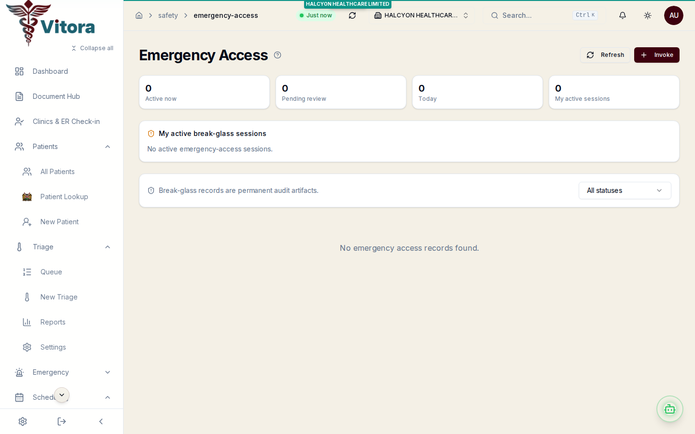{ width=95% fig-pos="H" }

### 2.5 Data Entry and Validation

Apply the following controls to every data-entry workflow:

1. Confirm the selected facility, patient, encounter, order, invoice, or report period before entering or changing data.
2. Use at least two approved patient identifiers before creating, opening, updating, ordering, dispensing, admitting, discharging, billing, or reporting on a patient record.
3. Complete all required fields. A validation message means the system has not accepted the save or submission until the indicated issue is corrected.
4. Check dates, units, quantities, medicine dose/route/frequency, laboratory ranges, payer identifiers, and financial totals against source information before finalizing.
5. Use the Kenya location cascade in order: county, sub-county, then ward. Do not select an unrelated location to bypass validation.
6. Search for an existing patient before registration. Escalate potential duplicates through the authorized records workflow; do not create a duplicate record to continue work.
7. Record a clear rationale when overriding a CDS alert or when correcting, cancelling, voiding, refunding, reversing, or resubmitting a record.
8. Treat a local save as distinct from an external submission. Confirm the returned DHA, SHA, DHIS2, KHIS, MOH, eTIMS, or payer response before recording the workflow as complete.
9. If an error is identified after saving, use the authorized amendment, correction, cancellation, reversal, or incident workflow. Do not delete or overwrite information to conceal an error.

## 3. Access, Roles, and First Use

### 3.1 Roles and facility capabilities

Vitora applies two controls before showing or allowing a function:

1. **Role-based access control (RBAC):** determines what a user may view or do.
2. **Facility capability control:** determines which services are enabled at the selected facility.

For example, a pharmacist may see dispensing only where the Pharmacy module is enabled. A billing officer may record payments but not necessarily prescribe medication. Administrators manage roles, facilities, departments, and enabled modules through the administration area.

#### Operational user groups and typical access boundaries

The following are training and workflow groupings, not an exhaustive list of system RBAC role codes. They help users identify their usual responsibilities and escalation boundaries; they do not independently grant access.

| Operational user group | Typical authorized activities | Access and escalation boundary |
|---|---|---|
| Reception / records | Patient search, duplicate prevention, registration, demographics, check-in, and authorized contact updates | Does not make clinical decisions, verify laboratory results, dispense, or submit financial/payer transactions unless specifically authorized. |
| Nurse / triage | Check-in support, triage, vital signs, queue updates, nursing documentation, and assigned inpatient tasks | Escalates unstable patients and works within assigned clinical/shift authority. |
| Clinician | Encounters, diagnoses, treatment plans, orders, referrals, clinical documentation, and CDS alert disposition | Remains accountable for clinical decisions; AI/CDS does not prescribe or authorize care. |
| Laboratory | Orders/specimens within role, result entry, verification, critical-result escalation, and laboratory quality workflows | Only authorized laboratory personnel verify results or configure analyzer, reflex, or auto-verification rules. |
| Pharmacy | Prescription review, medication-safety checks, dispensing, stock visibility, and authorized inventory actions | Dispenses only through the authorized pharmacy workflow after required clinical and stock checks. |
| Billing / claims | Invoices, payments, receipts, authorized adjustments, payer validation, claims, preauthorizations, remittances, and reconciliation | Does not alter clinical records to resolve payer or financial outcomes; external submission requires returned status confirmation. |
| Facility administrator | Staff, roles, departments, facilities, clinics, modules, invitations, configuration, audit review, and approved integration settings | Applies least privilege; does not use administration controls as a substitute for clinical or financial authorization. |
| IT / hub support | Desktop/hub operation, connectivity, backup/recovery support, technical troubleshooting, and escalation | Uses approved support and incident processes; does not access patient data without a legitimate, authorized purpose. |

Actual menu visibility and permitted actions are determined by the assigned RBAC permissions, selected facility, enabled modules, active-shift controls where applicable, and workflow state. The authoritative application role catalogue and permission matrix are maintained in Vitora RBAC configuration by authorized administrators.

### 3.2 Sign in and MFA

1. Open the approved Vitora web address, desktop application, or facility-hub address.
2. Enter your username or registered email address and password.
3. Complete the MFA challenge when prompted. MFA may use a TOTP authenticator or an enrolled passkey, according to facility policy.
4. Complete mandatory password-change, organization-activation, or onboarding prompts before entering the dashboard.
5. Select the appropriate organization and facility if the user is assigned to more than one.

Use **Forgot password** only through the approved email recovery process. Contact a system administrator if the account is disabled, the facility is not available, or MFA recovery is needed.

\clearpage
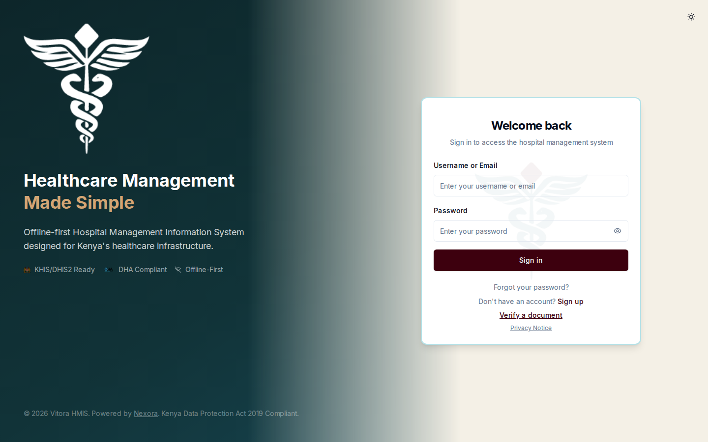{ width=95% fig-pos="H" }

\clearpage
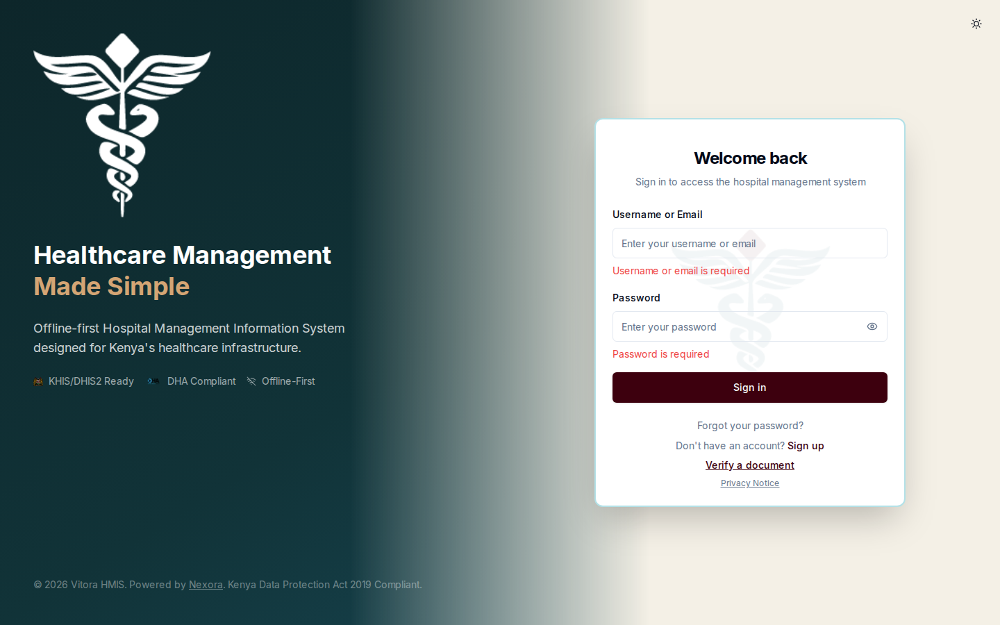{ width=95% fig-pos="H" }

\clearpage
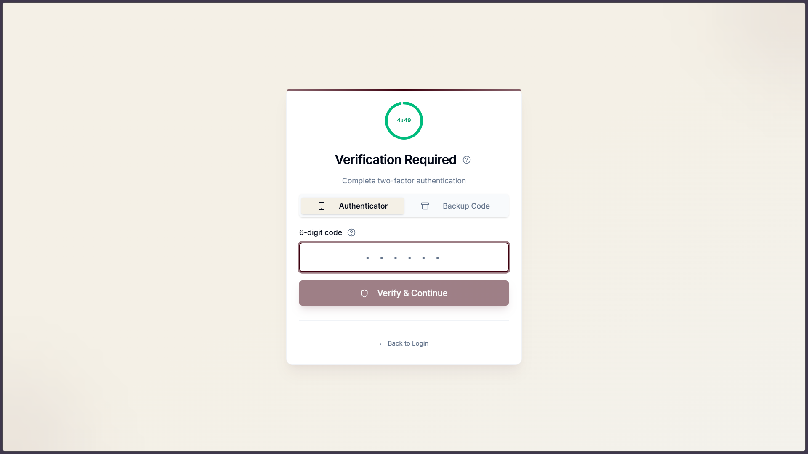{ width=95% fig-pos="H" }

### 3.3 Dashboard and navigation

The dashboard summarizes work queues, notifications, scheduling information, and facility activity according to the user role. Use the sidebar to open modules. On small screens, open the navigation menu from the menu control.

Common clinical navigation:

- **Patients** for registration, search, history, and shared health records where enabled.
- **Triage** for arrival assessment and queue prioritization.
- **Encounters** for consultation, diagnoses, plans, orders, and clinical documentation.
- **CDS Alerts** and **AI Assistant** for decision-support functions where enabled.
- **Clinics, Laboratory, Pharmacy, Billing, Inpatient, Imaging, MCH, Immunizations, Surveillance, and Scheduling** for service-specific workflows.

\clearpage
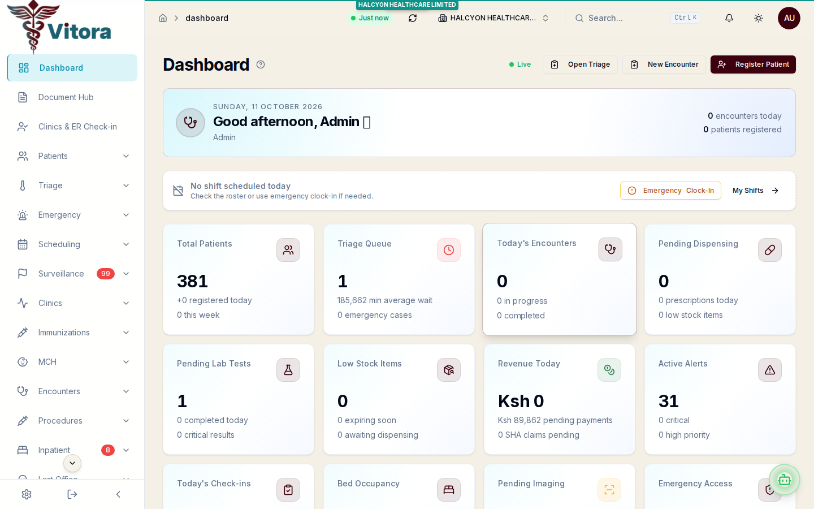{ width=95% fig-pos="H" }

## 4. Patient and Clinic Workflows

### 4.1 Register a patient

1. Go to **Patients → New Patient**.
2. Search first for an existing record using the facility-approved identifiers to reduce duplicate registration.
3. Enter demographics, date of birth, sex/gender, Kenya location details, contact information, consent, and registration details.
4. Mark a record as sensitive only where clinically and operationally justified under facility policy.
5. Add emergency contacts where available.
6. Review the patient identity and select **Save**.

The system generates the medical record number (MRN). Do not attempt to create or manually alter the MRN. If a duplicate is suspected, use the duplicate-record workflow or escalate to the records officer; do not create a second patient record to work around a search issue.

\clearpage
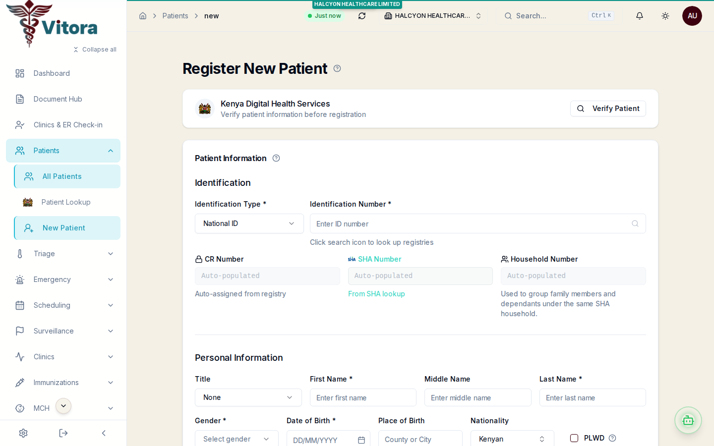{ width=95% fig-pos="H" }

### 4.2 Find and review a patient

1. Go to **Patients → All Patients**.
2. Search by permitted identifiers, name, MRN, or available filters.
3. Confirm at least two patient identifiers before opening or acting on the record.
4. Use the patient page to review demographics, alerts, allergies, encounters, history, contacts, invoices, and other authorized records.

Patient lookup and Shared Health Record functions require internet connectivity and appropriate permissions. External results must be reviewed and confirmed before they are incorporated into local care.

\clearpage
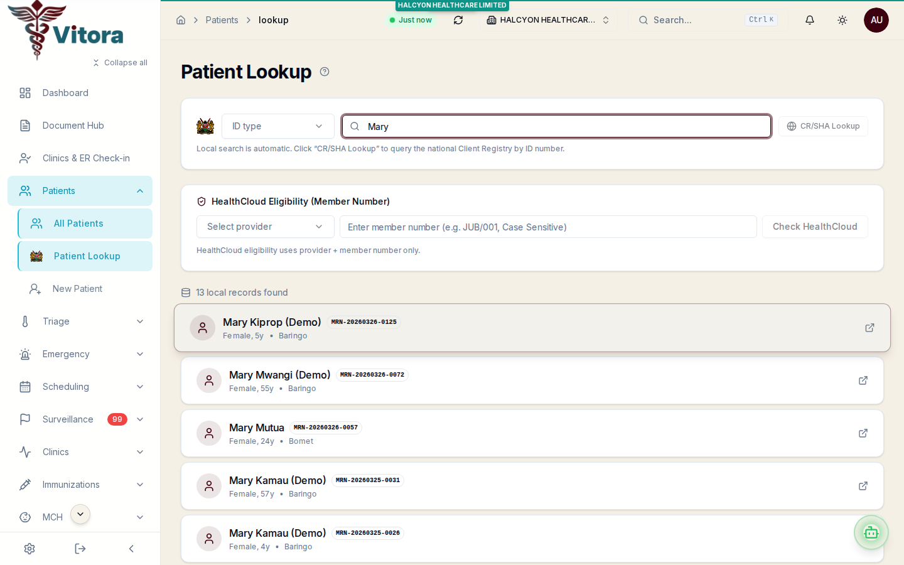{ width=95% fig-pos="H" }

\clearpage
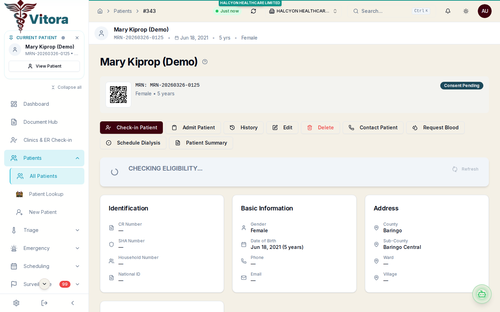{ width=95% fig-pos="H" }

### 4.3 Check-in and clinic routing

1. Open **Clinics & ER Check-in** or **Patients → Check-in**.
2. Identify the patient and choose the facility, clinic, visit reason, and destination as required.
3. Confirm the selected queue, clinic, and urgency.
4. Save the check-in and direct the patient according to facility procedure.

Clinic teams use clinic sessions, visits, linked rooms, and public queue displays where enabled. Do not display identifying clinical information on a public queue screen.

\clearpage
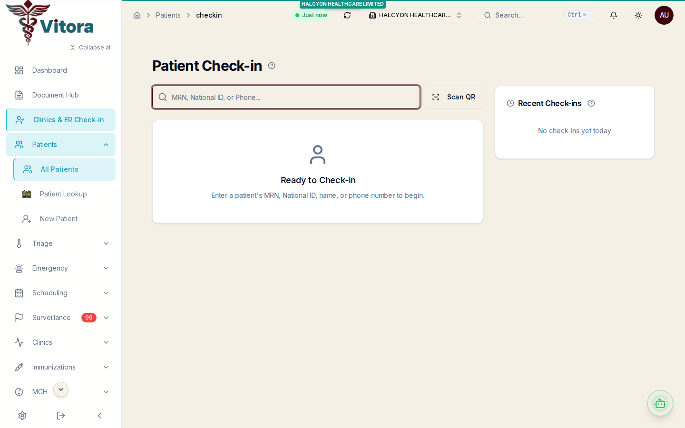{ width=95% fig-pos="H" }

### 4.4 Triage

1. Open **Triage → New Triage** or select the patient from the waiting queue.
2. Confirm patient identity and record arrival details, chief complaint, measurements, vital signs, pain score, mental status, mobility, and applicable clinical observations.
3. Review the calculated triage category and any critical-vital prompts.
4. Assign the patient to the appropriate area, clinic, clinician, or emergency workflow according to local protocol.
5. Complete the assessment and update the queue.

Triage prioritization supports clinical workflow but does not replace emergency assessment. Escalate unstable patients immediately under facility policy.

\clearpage
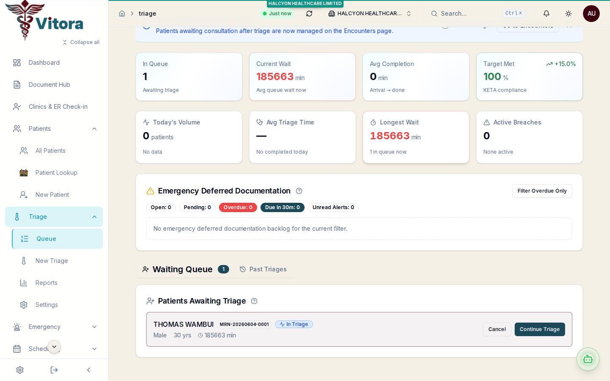{ width=95% fig-pos="H" }

### 4.5 Create and complete an encounter

1. Open **Encounters → New Encounter**, or begin from a clinic or triage queue.
2. Confirm the patient and encounter type.
3. Record the chief complaint, history, physical findings, vital signs, diagnoses, allergies, medications, clinical notes, treatment plan, orders, referrals, and follow-up as applicable.
4. Review in-page CDS alerts and complete the required clinical action or alert disposition.
5. Save progress during consultation. Finalize or close the encounter only after confirming the record is complete and all critical issues are addressed or documented.

Use the encounter history to correct data through authorized amendment workflows. Do not overwrite another clinician's clinical decision without an appropriate correction or addendum.

\clearpage
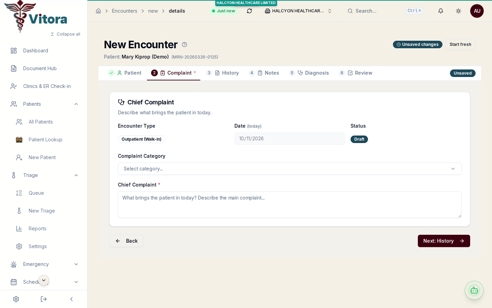{ width=95% fig-pos="H" }

### 4.6 Referrals, sick notes, and documents

Where enabled, **Encounters → Referrals** supports creation, tracking, acceptance, and closure of referrals. Verify destination, reason, clinical summary, urgency, attachments, and receiving contact before submission.

Use **Sick Notes** and the Document Hub only for approved templates and authorized documentation. Review generated or pre-populated text before signing, printing, issuing, or sharing it.

## 5. Clinical Decision Support and AI-Assisted Features

### 5.1 CDS purpose and limits

Vitora CDS is a rule-driven, advisory-only system. It evaluates configured rules against available patient and encounter data, including vital signs, allergies, medications, and laboratory results. It can display alerts but does not automatically place orders, prescribe medicines, administer treatment, change a diagnosis, or block a clinician from using professional judgment.

Rules are governed by authorized clinical users and administrators. Only approved, active rules should be used in production. Each rule carries a category, priority, evidence level, reference list, recommendation, and lifecycle state.

### 5.2 Rule-based CDS alerts

Configured CDS categories include:

| Category | Example use |
|---|---|
| Vital sign | Low oxygen saturation, fever, tachycardia, hypertension, abnormal respiratory rate |
| Drug-allergy | Potential prescribing conflict with a documented allergy or cross-reactive substance |
| Drug-drug | Potential interaction between prescribed/current medicines |
| Critical laboratory result | Configured critical thresholds for potassium, sodium, glucose, haemoglobin, creatinine, or locally approved tests |
| Guideline, preventive, and dosage | Facility-approved rules when configured |

Alert priorities are **Critical, High, Medium, Low,** and **Information**. Critical alerts receive prominent presentation. The priority indicates the rule configuration; it is not an automatic diagnosis or clinical order.

### 5.3 Respond to a CDS alert

1. Read the alert message, triggering value/context, proposed action, evidence level, and cited reference where displayed.
2. Verify that the patient, clinical context, values, units, medicines, and allergies are correct.
3. Decide the appropriate clinical action using professional judgment and local policy.
4. Select one of the available dispositions:

| Disposition | Appropriate use |
|---|---|
| Acknowledge | The alert has been seen and remains under review. |
| Accept | The recommendation is clinically appropriate and has been acted on or incorporated into the documented plan. |
| Override | A different clinical decision is justified. Enter a clear clinical rationale; the system requires a substantive reason. |
| Dismiss | The alert is not applicable, after checking the underlying information. |
| Auto-resolved | System status used when the trigger no longer applies; review it where relevant. |

5. Document the clinical assessment and final plan in the encounter, order, prescription, or progress note. Alert disposition alone is not adequate clinical documentation.

Alerts are auditable with the triggering user, resolving user, time, status, and override rationale. The system avoids duplicate pending alerts for the same applicable rule and patient.

\clearpage
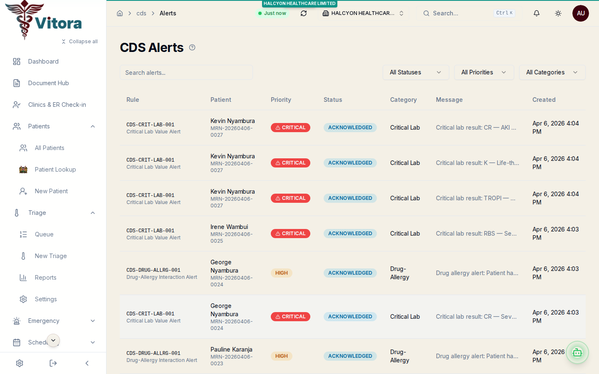{ width=95% fig-pos="H" }

### 5.4 CDS rule administration

Authorized clinical governance users may open **CDS → Rules** to review rule status, category, priority, evidence level, references, condition, and recommendation.

Rule lifecycle:

```text
Draft -> Active -> Inactive -> Retired
```

Before activating or changing a rule:

1. Obtain approval under the facility clinical-governance process.
2. Confirm the guideline reference, intended population, thresholds, units, exclusions, priority, and recommended action.
3. Test the rule using representative non-production data or approved validation procedures.
4. Ensure relevant users are trained on the alert and escalation expectation.
5. Record approval, version, effective date, and review date according to facility governance.

Retire a rule rather than silently deleting a rule that has generated clinical alerts, unless the authorized retention and change-control procedure explicitly allows deletion.

### 5.5 Smart autopopulation

If the facility enables smart autopopulation, CDS and AI can offer structured values such as a suggested diagnosis, assessment element, history entry, encounter field, or order-related action. The clinician must review each suggestion and explicitly accept, modify, or reject it before it becomes part of the clinical record.

Do not accept a suggestion solely because it is displayed. Confirm source data, relevance, contraindications, dose, and clinical appropriateness.

### 5.6 TibaBot-assisted clinical functions

TibaBot features are optional and require enabled facility configuration, authorized access, and connectivity to the configured AI service. Availability, response time, and supported outputs can vary by configured service.

| Feature | Intended support | Required user action |
|---|---|---|
| Clinical assistant/chat | Clinical information retrieval and structured assistance | Verify every statement against clinical evidence and patient context. |
| ICD-10 suggestion | Suggested coding from clinical text | Select and validate the code; do not rely on a suggestion without review. |
| Care-plan generation | Structured goals, interventions, follow-up, and ADPIE-style content | Edit to the patient-specific plan and sign only after clinician review. |
| Lab interpretation | Flags, patterns, and contextual explanation | Review original result, units, reference range, specimen quality, and urgency. |
| Discharge readiness | Suggested readiness criteria and outstanding concerns | The responsible clinician makes the discharge decision. |
| ICU risk or qSOFA/SOFA support | Risk-oriented analysis and score support | Verify all input data and follow local escalation policy. |
| Condition prediction | Probability-oriented or differential-support information | Do not treat as a confirmed diagnosis. |
| Clerking autocomplete/structuring | Draft wording or conversion of free text to structured note sections | Verify accuracy, omissions, negations, and authorship before saving. |
| Investigation suggestions | Suggested work-up options | Order only clinically indicated investigations. |
| ECG support where enabled | ECG interpretation, comparison, report drafting, and risk-score assistance | Clinician reviews waveform, patient context, and final report. |

Additional enabled TibaBot functions include drug-formulary lookup, approved facility knowledge-base retrieval, clinician feedback, and operational insights. Formulary and knowledge-base content are reference/support material; users must check current local formulary, approved guidelines, and patient-specific contraindications. Only authorized administrators may add, remove, or govern facility knowledge-base documents. Do not upload unapproved patient-identifying documents or copyrighted material without an approved lawful basis and supplier/data-sharing assessment.

For all AI-assisted outputs:

1. Check the patient and encounter context before requesting a result.
2. Do not enter unnecessary direct identifiers into free-text prompts.
3. Review the complete output, not only highlighted recommendations.
4. Compare against source data, guidelines, contraindications, and local availability.
5. Correct, reject, or document limitations where the output is incomplete, inappropriate, or uncertain.
6. Record the final clinician-authored decision in the clinical record.

If AI is unavailable or an output fails validation, continue using standard clinical workflow. Rule-based local CDS can remain available even when a remote AI service is unavailable.

## 6. Laboratory, Pharmacy, Inventory, and Billing

### 6.1 Laboratory

Use **Laboratory** to create and manage lab orders, order items, specimens, results, verification, critical-result workflows, quality-control records, culture results, and analyzer integration functions where configured.

Standard workflow:

1. Confirm patient and encounter.
2. Create the order and select requested tests, priority, sample/specimen details, and clinical notes.
3. Collect and track the specimen according to laboratory procedure.
4. Enter, receive, or interface results; confirm units, ranges, flags, and patient identity.
5. Verify results only if authorized.
6. Escalate critical values using the laboratory's approved communication process and record the communication where required.

AI lab interpretation and CDS critical-lab alerts assist review; they do not verify a laboratory result or replace laboratory authorization.

\clearpage
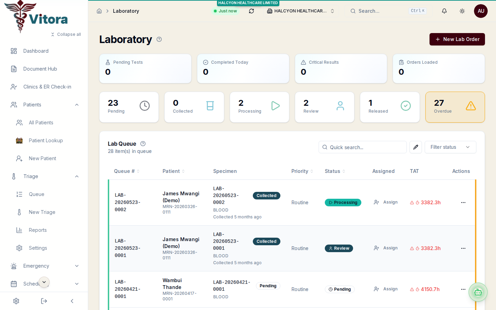{ width=95% fig-pos="H" }

\clearpage
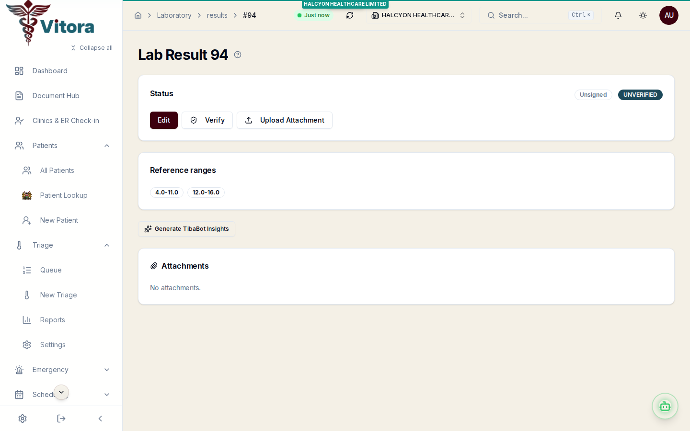{ width=95% fig-pos="H" }

### 6.2 Pharmacy and inventory

Use **Pharmacy** for prescriptions, dispensing, drug catalogues, external prescriptions, stock visibility, stock adjustment, goods receipt, purchase orders, transfers, stock counts, suppliers, and reports according to the facility's enabled capabilities.

Prescription and dispensing workflow:

1. Confirm patient, encounter, medicine, dose, route, frequency, duration, allergies, and prescriber instructions.
2. Review relevant CDS medication alerts.
3. Check stock availability, batch/expiry information, substitutions, and restrictions.
4. Dispense only under authorized pharmacy workflow.
5. Record quantity supplied, counselled information, substitution/cancellation reason, and final status.

Inventory changes are accountable actions. Do not use stock adjustments to correct a clinical prescription; correct the appropriate clinical or dispensing record instead.

\clearpage
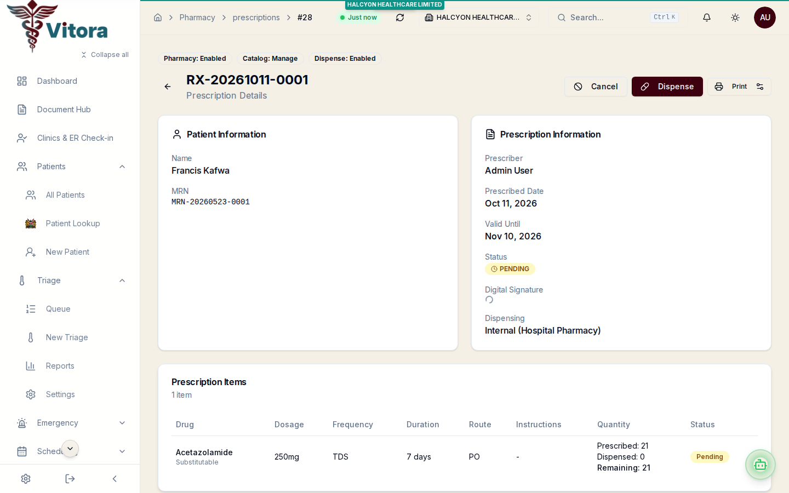{ width=95% fig-pos="H" }

\clearpage
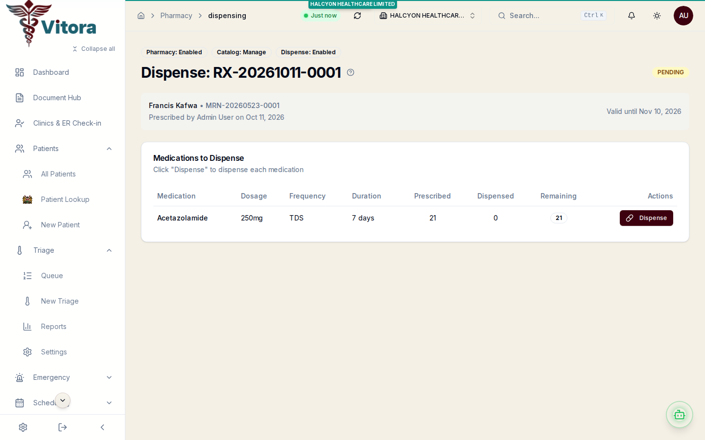{ width=95% fig-pos="H" }

### 6.3 Inventory and procurement

Use **Inventory** where enabled to manage suppliers, purchase orders, formal goods receipts, store locations, transfers, ward stock, stock counts, forecasting, and Kenya eTIMS functions where configured.

1. Create or approve purchase orders only under the facility procurement authority.
2. On receipt, verify supplier, order, item, quantity, batch/lot, expiry, condition, and store location before posting a goods receipt.
3. Use stock transfers for movement between authorized stores/wards and confirm receipt at destination.
4. Conduct stock counts using the count workflow; investigate and authorize variances before adjustment.
5. Use eTIMS only when the facility is configured for it and the responsible finance/tax user has verified the source transaction.

Forecasting is an operational planning aid. It does not replace procurement approval, stock verification, cold-chain control, or clinical formulary governance.

#### eTIMS

eTIMS functions are available only to eligible Kenya-configured facilities with the required KRA configuration and authorized users. Before transmitting or accepting an eTIMS record:

1. Confirm the underlying invoice, item/service, tax treatment, patient/payer context, and financial approval are correct.
2. Use the eTIMS workflow to create, validate, submit, and monitor the fiscal record according to the facility's tax procedure.
3. Investigate rejected, duplicated, cancelled, or unavailable submissions before reattempting them.
4. Reconcile eTIMS responses with the original invoice/credit-note trail; do not create a replacement clinical or billing record merely to resolve a fiscal-submission failure.

eTIMS status is not proof that a clinical service was delivered, a payer claim was approved, or payment was received.

### 6.4 Billing, payment, and insurance

Use **Billing** to create invoices, add approved services/items, apply authorized discounts, record payments, issue receipts, manage payment points, and follow claims/insurance workflows.

1. Confirm the patient, facility, encounter, payer, and billable items.
2. Review quantities, prices, coverage, exemptions, and any applicable authorization before finalizing.
3. Record payment using the correct method and payment point.
4. Issue or reprint a receipt only after confirming the transaction.
5. Void, refund, adjust, or cancel only when authorized and with the required reason/audit trail.

Use proformas for quotations or preliminary billing where enabled. Convert, cancel, issue credit notes, reconcile, and manage supplier bills only through the corresponding authorized finance workflow. A financial correction must preserve the original transaction trail and reason.

\clearpage
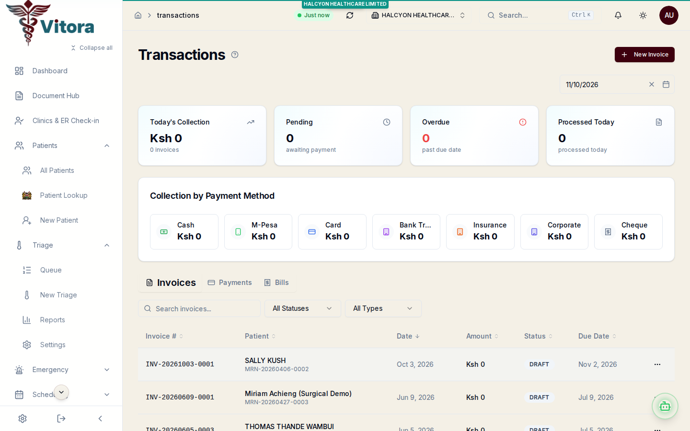{ width=95% fig-pos="H" }

### 6.5 SHA/DHA and private-insurance workflows

Where configured and approved, Vitora supports eligibility checking, patient consent, visit authorization, biometric authorization through DHA-supported workflows, claims, preauthorizations, intervention lifecycle actions, payer adjudication previews, remittances, and selected private-insurance workflows.

Before submitting a payer request:

1. Confirm patient identity, eligibility, payer identifiers, facility/practitioner details, service data, documents, and consent requirements.
2. Validate the claim or authorization response in Vitora.
3. Resolve all validation errors and document clinical/financial corrections in the source record.
4. Submit only from an authorized user account.
5. Monitor returned status, queries, deadlines, remittance, and reconciliation.

External payer responses are not a clinical decision. A DHA biometric iframe may use DHA-supported scanner or middleware capability; Vitora does not directly control a local fingerprint scanner.

Private-insurance functions can include provider configuration, enrolments, claims, authorizations, preauthorizations, reservations, remittances, tariffs, and credentials. Use these only after the payer connection, facility contract, staff authority, and online status have been verified. Do not enter or disclose payer credentials in clinical notes or free-text fields.

\clearpage
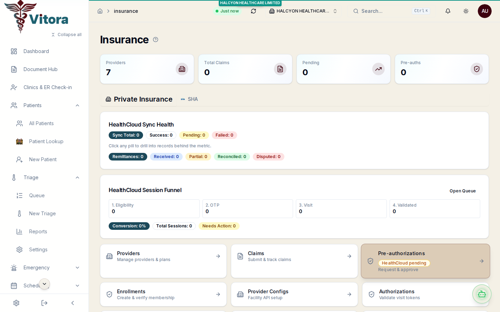{ width=95% fig-pos="H" }

\clearpage
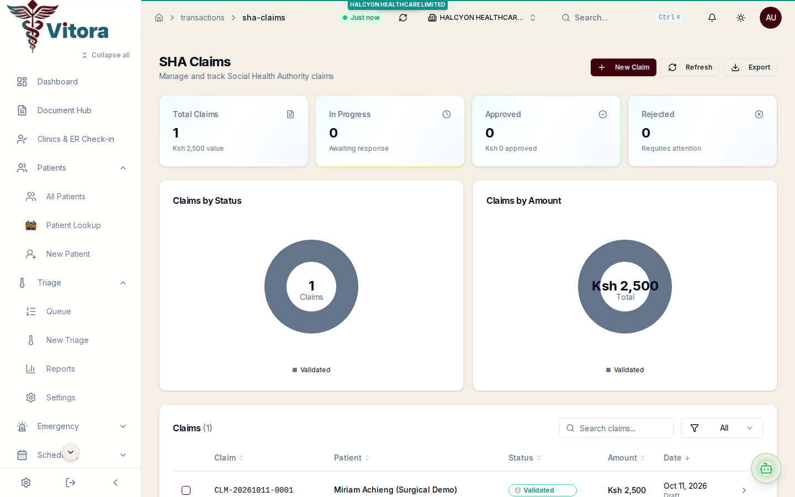{ width=95% fig-pos="H" }

\clearpage
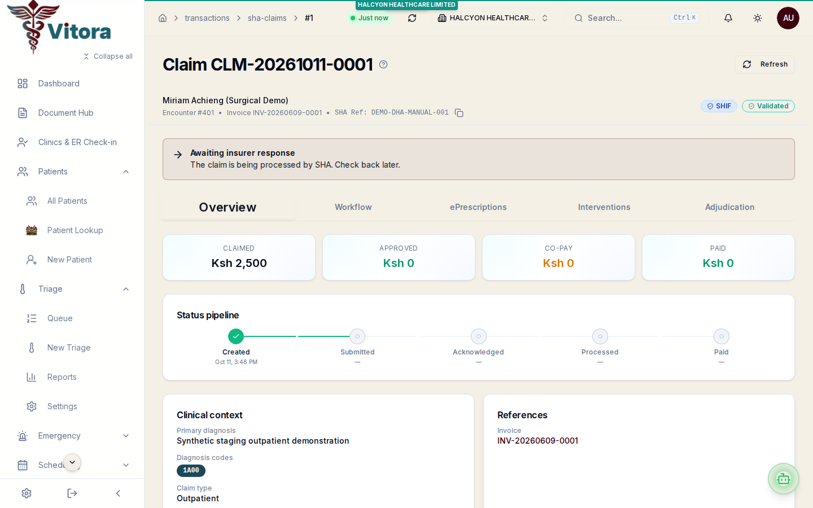{ width=95% fig-pos="H" }

#### Private-insurance workflow

1. Confirm the patient identity, insurer, scheme, membership/enrolment status, benefit limits, tariff, and required authorization before care is represented as covered.
2. Create the authorization, reservation, preauthorization, or claim from the approved encounter/invoice context.
3. Attach only required, authorized clinical and financial documents.
4. Track payer responses, queries, approval/denial, remittance, and reconciliation through the Insurance workflow.
5. Record a correction, resubmission, or write-off through the authorized financial process; do not alter the clinical record to match a payer response.

## 7. Inpatient, Procedures, Imaging, and Emergency Care

### 7.1 Inpatient care

The **Inpatient** module supports ward and bed configuration, bed boards, admission requests, admissions, transfers, inter-facility transfer queues, handover, reviews, nursing Kardex, ward rounds, discharge, and related nursing/procedure workflows where enabled.

1. Confirm patient and admission basis.
2. Select the appropriate ward/bed and record admission details.
3. Use handover, Kardex, rounds, reviews, medication administration, and notes according to role and policy.
4. Record transfers using the transfer workflow; do not merely change bed fields outside the approved process.
5. Before discharge, reconcile diagnoses, medicines, follow-up, referrals, discharge instructions, billing, and outstanding results.

Discharge-readiness support can identify possible missing criteria. It cannot authorize discharge. The responsible clinician remains accountable.

### 7.2 Last Office (mortuary) records

Where the Mortuary/Last Office module is enabled, use **Last Office → Record Death** and the record list to document deceased-patient workflows under facility policy. Confirm patient identity, the authoritative clinical/legal determination, required time and responsible practitioner, next-of-kin/chain-of-custody requirements, and applicable statutory documentation before recording a death. This module does not replace legal death certification, medico-legal reporting, or mortuary chain-of-custody procedures.

### 7.3 Procedures and theatre

Use **Procedures** and **Theatre** functions where enabled to manage procedure catalogues, orders, external requests, room assignments, theatre cases, checklists, reports, and related clinical documentation.

Confirm consent, patient identity, procedure, laterality/site where applicable, clinical readiness, staff roles, equipment, and post-procedure plan under the facility's surgical safety policy. System checklists support but do not replace the WHO Surgical Safety Checklist or local mandatory checks.

### 7.4 Imaging and DICOM

Use **Imaging** to create orders, manage studies, upload/retrieve DICOM material, view images, prepare reports, attach documents, and manage controlled sharing where enabled.

1. Confirm patient, order, modality, body site, clinical indication, and identifiers before upload or retrieval.
2. Verify DICOM matching before associating an image with a patient record.
3. Restrict sharing to approved recipients and expiry/access controls.
4. A qualified reporting clinician must validate any report before clinical use.

### 7.5 Emergency services

Where the Emergency module is enabled, use the dashboard, bed board, triage, queues, emergency zones, and relevant clinical workflows to coordinate care. The electronic queue is a coordination aid. Immediate life-threatening conditions must be managed under emergency protocols regardless of dashboard, bed-board, or connectivity status.

### 7.6 Dialysis, blood bank, and allied-health services

Where enabled, specialty modules support the facility's configured dialysis, blood-bank, physiotherapy, occupational-therapy, nutrition, social-work, counselling, chronic-care, eye, dental, and surgical-clinic workflows.

Users must follow the service-specific clinical SOP, qualification requirements, consent process, and required independent checks. In particular:

- Validate patient identity, clinical order, indication, contraindications, and source documentation before recording a specialty intervention.
- Record the responsible practitioner, observations, intervention, complications, and follow-up in the applicable specialist workflow.
- Use blood-bank and transfusion functions only with the mandatory patient/component compatibility and bedside-check controls required by facility policy. Vitora does not replace those controls.
- Treat specialty templates and AI/CDS suggestions as editable support content, not a substitute for a specialist assessment.

Use the Blood Bank module for authorized donor, unit, request, and cross-match workflows. Use the Dialysis module for dialysis orders, vascular access, sessions, and associated observations. These are distinct workflows, not generic encounter notes: capture the required patient checks, order/indication, product or access details, observations, reactions/complications, accountable staff member, and outcome in the appropriate record.

### 7.7 Detailed laboratory and imaging operations

Laboratory users may additionally use test catalogues, verification queues, quality control, external quality assessment/proficiency testing, analyzer configuration/interface monitoring, microbiology, worksheets, reflex testing, auto-verification, critical-value configuration, analytics, and service-level performance views where enabled.

- Only authorized laboratory personnel may configure analyzers, test catalogues, critical thresholds, reflex rules, or auto-verification rules.
- Auto-verification is a configured workflow aid; review exceptions, delta checks, flags, specimen issues, and locally defined hold criteria before release.
- For standalone/walk-in and external orders, establish the patient/order identity and ordering source before processing; do not merge records based solely on a similar name.

Imaging users may additionally use worklists, reporting queues, equipment records, procedure catalogues, local viewers, and standalone/external orders. Confirm worklist patient matching and modality/workstation context before acquisition, upload, report finalization, or DICOM association.

## 8. MCH, Immunization, Public Health, and Surveillance

### 8.1 Maternal and child health

The MCH module supports registrations, ANC/PNC and related clinic workflows, deliveries, labour/partograph functions where enabled, growth monitoring, HEI follow-up, and linked immunization services.

Confirm mother/child linkage, gestational or age information, visit date, observations, interventions, counselling, and follow-up plan before saving. Escalate danger signs under local maternity and newborn protocols.

### 8.2 Immunization

The Immunizations module supports vaccination records, configuration, campaigns, AEFI reports, stock, cold-chain equipment/logs, incidents, and coverage reporting where enabled.

Before recording administration, verify patient identity, age/eligibility, product, batch, expiry, dose, route, consent, contraindications, and facility protocol. Record suspected AEFIs promptly and use the designated public-health reporting workflow.

### 8.3 Surveillance and reporting

The Surveillance module supports notifiable cases, contact tracing, alerts, thresholds, IDSR reports, IHR compliance workflows, and DHIS2-related reporting where configured.

1. Record the case using the approved case definition and available evidence.
2. Complete required classification, patient, facility, laboratory, and epidemiological information.
3. Review deadlines, thresholds, and escalation prompts.
4. Submit IDSR, IHR, or DHIS2 information only after authorized review and where internet connectivity/configuration is available.
5. Retain local documentation and follow facility/public-health escalation rules if an external submission fails.

#### DHIS2, KHIS, MOH, and SDMX reporting

DHIS2/KHIS, MOH-reporting, and SDMX functions are external reporting integrations and require configured credentials, mapping, authorized reporting periods, and internet connectivity. They are not a replacement for source clinical records.

1. Complete and verify source records before preparing an aggregate report.
2. Select the correct facility, organisation unit, reporting period, program/data elements, and report type.
3. Review calculated totals, missing values, validation messages, and any mapped indicators before submission.
4. Submit only under the facility's approved reporting authority.
5. Record/retain the returned submission status and resolve rejected or partial imports using the source record and reporting correction procedure.
6. Never enter fabricated values merely to satisfy a reporting deadline. Escalate unavailable data, mapping defects, or endpoint failure to the responsible reporting lead.

KHIS/DHIS2 availability and accepted submission are dependent on the external platform. The user must confirm the returned acceptance/import status rather than assuming a local save has completed an external submission.

\clearpage
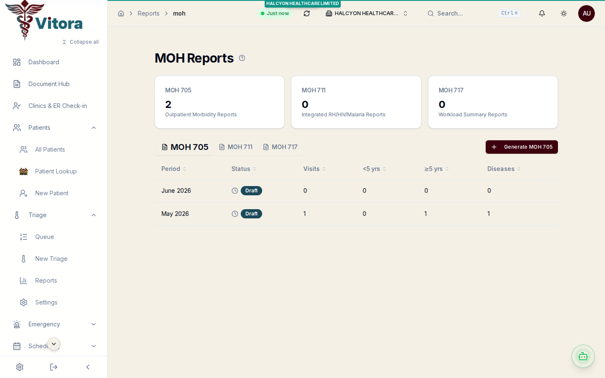{ width=95% fig-pos="H" }

\clearpage
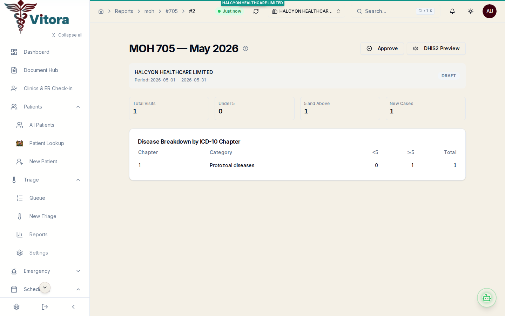{ width=95% fig-pos="H" }

### 8.4 Quality improvement and population reporting

Where enabled, the Quality module supports quality measures, benchmarks, domain views, quarterly/annual reports, and improvement tracking. Authorized users should validate source data, reporting period, numerator/denominator definitions, and governance approval before publishing, exporting, or acting on performance information.

Population and operational analytics are decision-support tools. Do not use aggregate dashboards to identify or make care decisions about an individual without returning to the authorized clinical record.

## 9. Scheduling, Facilities, Documents, Reporting, and Administration

### 9.1 Scheduling and shifts

Use **Scheduling** for appointments, schedules, resources, weekly rosters, duty rosters, staff workload, personal shifts, swaps, vacancies, and assignments where authorized.

Staff should clock in/out, take breaks, and resume shifts accurately. Roster managers should review cross-facility conflicts, staff constraints, room availability, and workload before publishing changes. Write actions may require an active shift except for authorized administrative roles.

#### Appointments, resources, and clinic scheduling

1. Open **Scheduling → Appointments** and select the patient only after confirming identifiers.
2. Select the clinic, service, practitioner/resource, date, time, and appointment reason according to available slots and local booking policy.
3. Review clashes, clinic/session availability, room/resource assignment, and appointment status before saving.
4. Use reschedule, cancellation, no-show, queue, or check-in actions with the required reason and patient communication process.
5. Do not use a roster shift as a substitute for a patient appointment, and do not use an appointment status as evidence that care was delivered; document actual care in the encounter/visit workflow.

\clearpage
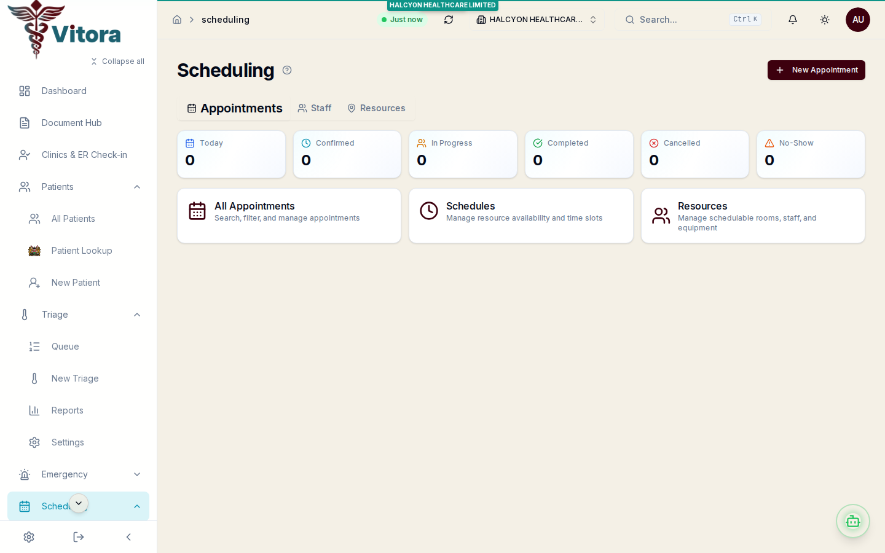{ width=95% fig-pos="H" }

### 9.2 Documents, reports, and analytics

Use the Document Hub, module reports, exports, analytics, and dashboards only within your authorized scope. Before printing, downloading, emailing, or exporting, confirm the recipient, minimum necessary data, and facility approval. Do not use exports as an uncontrolled clinical record or secondary data store.

#### Analytics and business intelligence

The **Analytics & BI** area and module dashboards can present operational, clinical, financial, quality, laboratory, pharmacy, and reporting indicators where the facility subscription and permissions allow them.

1. Confirm the dashboard facility, date range, filters, data-refresh status, and metric definitions before interpreting or distributing a result.
2. Treat dashboards as decision support. Drill into authorized source records before acting on an individual patient or material financial/clinical variance.
3. Use aggregated/de-identified views whenever identifiable data is unnecessary.
4. Export only the minimum necessary information, store it in an approved location, and apply the facility retention/access policy.
5. Report unexpected totals, missing data, stale refreshes, or cross-facility discrepancies; do not manually alter source records merely to make a dashboard metric appear correct.

\clearpage
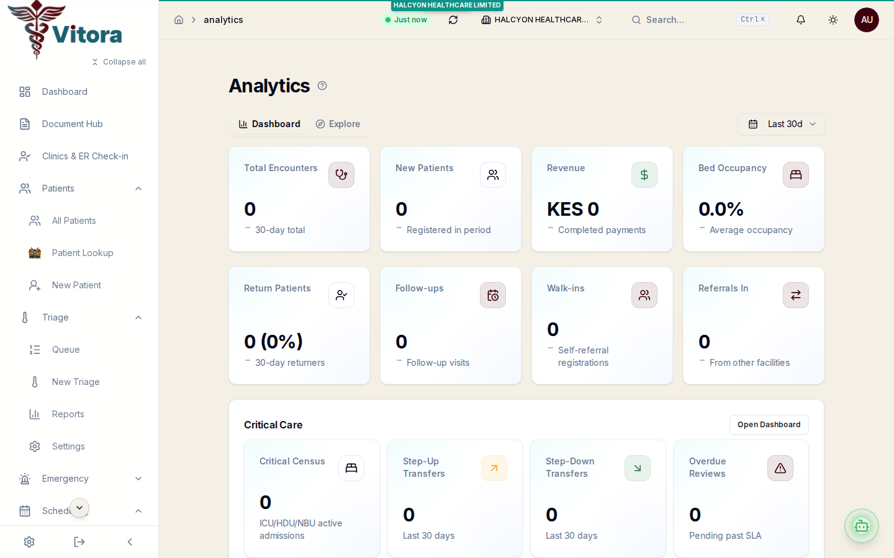{ width=95% fig-pos="H" }

### 9.3 Facility administration

Authorized administrators manage organizations, facilities, departments, roles, staff/memberships, invitations, clinics, resources, enabled modules, integration settings, audit views, certificates, licenses, and other configuration.

The administration area also provides authorized workflows for HWR/facility/SHA intervention lookup, HL7 message and endpoint monitoring, interoperability status, KENHDD compliance, certificates, installations, licensing, subscription administration, and audit-integrity review. These functions are configuration and support controls, not clinical data-entry shortcuts. Restrict integration credentials, certificates, endpoints, and license actions to trained administrators, and test changes under approved change control.

Administration principles:

- Apply least privilege and assign the minimum necessary role.
- Configure facility modules before training staff on a service.
- Test non-production or vendor integrations before production activation.
- Do not use the Django technical admin for normal tenant facility administration unless the platform access policy specifically permits it.
- Review audit logs and configuration changes periodically.

\clearpage
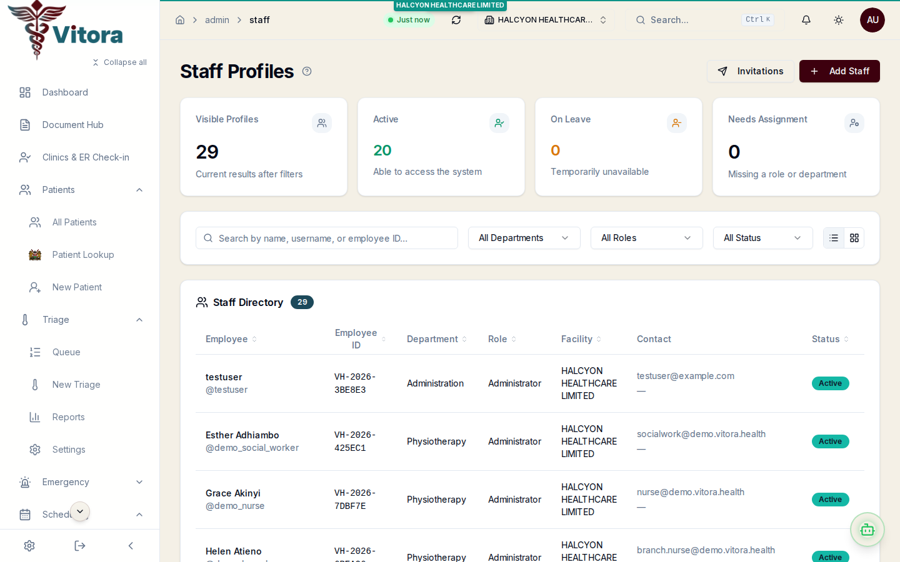{ width=95% fig-pos="H" }

## 10. Desktop, Hub, Connectivity, and Offline Working

### 10.1 Desktop application

The Vitora desktop application packages the web application in a Tauri shell with a local Next.js sidecar. It supports cloud standalone mode, LAN client mode, LAN hub mode, and configured web-oriented operation.

Desktop users can use native receipt printing where installed printers are available. The desktop client can check for signed updates and prompt the user to install them. Updates require a network connection and user confirmation.

The desktop app does not currently provide a general direct hardware interface for fingerprint readers, smart-card readers, USB/HID devices, serial devices, or laboratory instruments. A device may work only where its own DHA/vendor web or middleware integration is supported.

### 10.2 Facility hub

The facility hub is a local server, not the desktop client. It provides LAN access, a local SQLite database, WebSocket services, and cloud synchronization when connectivity returns.

During an internet outage:

1. Continue only with workflows available through the authorized hub/local deployment.
2. Record care contemporaneously in the authorized local workflow.
3. Do not attempt cloud-only functions such as external eligibility checks, DHA consent/biometric workflows, remote AI functions, Shared Health Record lookup, or public-health submission until connectivity is restored.
4. Review synchronization status after reconnection and resolve conflicts through the assigned workflow.

### 10.3 PowerSync browser mode

When PowerSync is configured, supported browser data is available through a scoped local SQLite projection. The client falls back to API behavior when PowerSync is not available. Encrypted direct identifiers and encryption keys are not replicated to the browser projection.

Offline availability does not authorize use on an unmanaged or shared device. Follow the facility's endpoint, session, and local-retention policy.

## 11. Audit, Corrections, and Incident Handling

### 11.1 Audit trail

Vitora records attributable events including authentication, access, create/update/delete activity, sensitive-record access, and selected workflow transitions. Audit records support accountability; they do not replace clinical documentation.

### 11.2 Correcting mistakes

1. Stop before submitting if the error is identified during entry.
2. If saved, use the authorized edit, amendment, correction, cancellation, void, or reversal workflow for that record type.
3. Do not delete or overwrite a record solely to hide an error.
4. Add a clear rationale where the workflow requests one.
5. Escalate material patient-identification, medication, result, billing, or reporting errors under the facility incident process.

### 11.3 Downtime and security incidents

For planned/unplanned downtime, use the facility-approved downtime procedure. Reconcile paper or temporary records into Vitora when the system is restored, preserving authorship and event timing where possible.

Immediately report suspected privacy breaches, account compromise, incorrect patient access, loss/theft of a device, malware, unexplained data change, or failed backup/recovery to the designated facility security/privacy officer and follow the incident-response plan.

## 12. Troubleshooting and Support

| Issue | First action | Escalate when |
|---|---|---|
| Cannot sign in | Check username/email, password, selected URL, connectivity, and MFA device. | Password reset, locked account, MFA loss, or facility activation is needed. |
| Feature/menu unavailable | Check selected facility, role, module access, subscription, and connectivity label. | The function should be enabled but remains unavailable. |
| Patient cannot be found | Search using multiple approved identifiers and confirm facility context. | Duplicate, merge, access, or data-quality review is needed. |
| CDS/AI unavailable | Continue standard clinical assessment and local policy workflow. | A critical configured alert or AI service failure needs technical review. |
| External claim/report fails | Save the source record, read the returned validation error, correct authorized data, and retry when appropriate. | Deadline, payer/DHA error, or submission uncertainty persists. |
| Desktop does not start | Restart once and review the visible error/log location provided by the client. | Sidecar, updater, installation, or recurring startup failure occurs. |
| Hub/network offline | Use approved local workflow and do not assume cloud submission occurred. | Sync does not recover or conflicts require review. |
| Suspected wrong patient/data exposure | Stop work on the record and notify the responsible officer immediately. | Always treat as a safety/privacy incident. |

## 13. Training and Approval Record

Each facility should retain evidence that users have received role-appropriate training before production access. Training should include patient identity verification, privacy, sensitive records, local downtime procedure, relevant clinical module workflows, alert/AI safety, claim/reporting responsibilities, and incident escalation.

| Role/group | Training scope | Trainer | Date | Competency/approval |
|---|---|---|---|---|
| Clinicians | Patients, encounters, orders, CDS, AI safety, referrals, discharge |  |  |  |
| Nurses/triage | Check-in, triage, vitals, queues, inpatient/MCH workflows |  |  |  |
| Laboratory | Orders, specimens, results, verification, critical-result escalation |  |  |  |
| Pharmacy | Prescribing/dispensing interface, stock, medication alerts |  |  |  |
| Billing/claims | Invoices, payments, SHA/DHA/private payer submission and reconciliation |  |  |  |
| Administrators | RBAC, modules, staff, audit, configuration, incident escalation |  |  |  |
| Hub/IT support | Desktop/hub operation, backup, recovery, connectivity, escalation |  |  |  |

## 14. Document Control

Review this manual at least annually and after a material change to clinical workflow, enabled module, CDS rule governance, AI provider, patient-data flow, DHA interface, role model, offline design, or security control.

| Version | Date | Change | Owner | Approval |
|---|---|---|---|---|
| 1.0 | 2026-10-04 | Initial DHA-facing comprehensive system user manual. | Clinical Governance and Engineering | Pending DHA, DPO, Security, and Clinical Governance review |
| 1.1 | 2026-10-11 | Added workflow-embedded screenshots, data-entry examples, reporting evidence, and expanded DHA review guidance. | Clinical Governance and Engineering | Pending DHA, DPO, Security, and Clinical Governance review |
